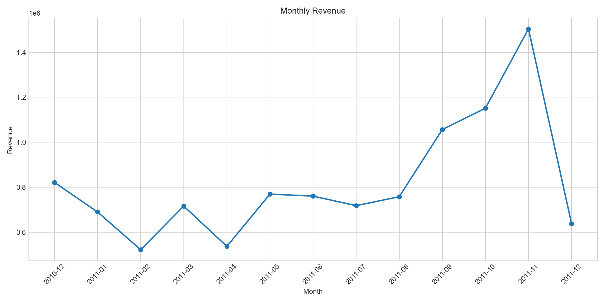
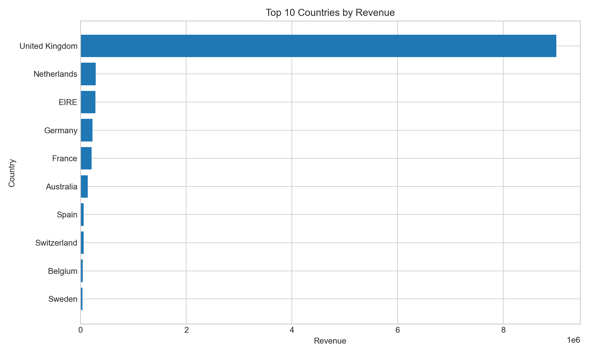
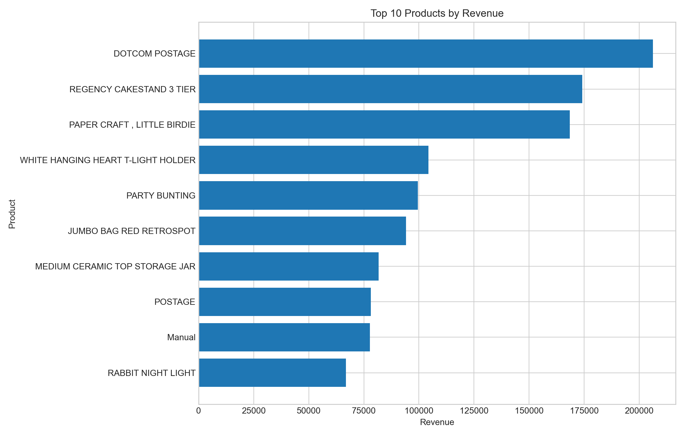
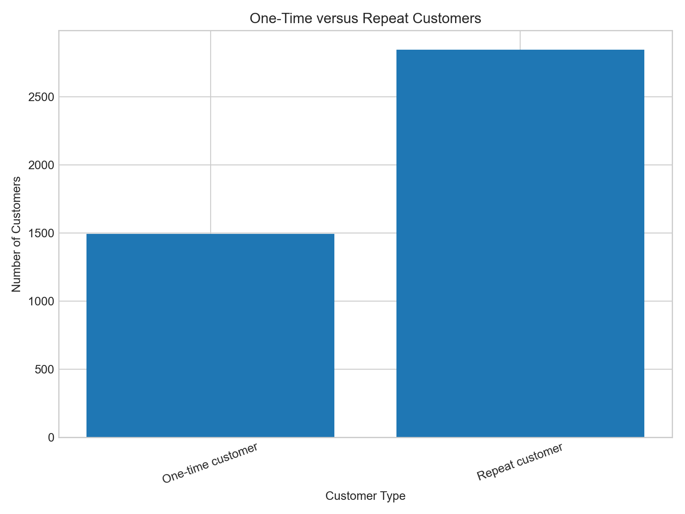
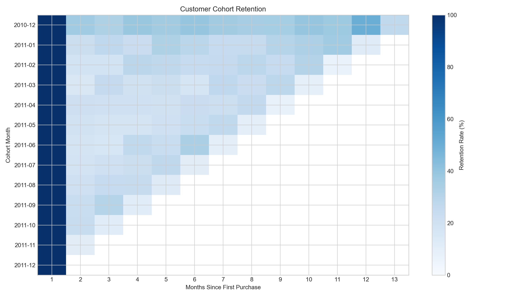

# Customer Revenue and Retention Analytics

An end-to-end e-commerce analytics project using Python and Pandas to analyze revenue, customer behavior, repeat purchasing, and cohort retention.

## Business objective

The goal is to help an e-commerce business understand:

- Revenue performance
- Product performance
- Geographic sales
- One-time versus repeat customers
- Customer retention by acquisition cohort
- High-value customer segments

## Dataset

This project uses the UCI Online Retail dataset.

The dataset contains transactions from a UK-based online retailer between December 2010 and December 2011.

Original dataset:

https://archive.ics.uci.edu/dataset/352/online+retail

## Key results

The cleaned analysis contains:

- **524,882 transaction lines**
- **19,962 orders**
- **3,922 products**
- **5,572,424 units sold**
- **£10.64 million in revenue**
- **38 countries**
- **4,338 identifiable customers**

The United Kingdom generated approximately **84.6% of total revenue**.

Repeat customers generated approximately **£8.27 million**, compared with approximately **£614 thousand** from one-time customers.

## Customer retention findings

The analysis identified:

- **1,493 one-time customers**
- **2,845 repeat customers**
- **1,054 high-value repeat customers**
- **1,791 regular customers**

The December 2010 cohort showed:

- **36.6% retention in month two**
- **32.3% retention in month three**

## Visualizations

### Monthly revenue



### Revenue by country



### Top products



### Customer segments



### Cohort retention



## Project workflow

```text
Raw Excel dataset
        ↓
Data profiling
        ↓
Transaction investigation
        ↓
Cleaning and business rules
        ↓
Data-quality validation
        ↓
Sales analysis
        ↓
Customer segmentation
        ↓
Cohort retention analysis
        ↓
Charts and business recommendations

